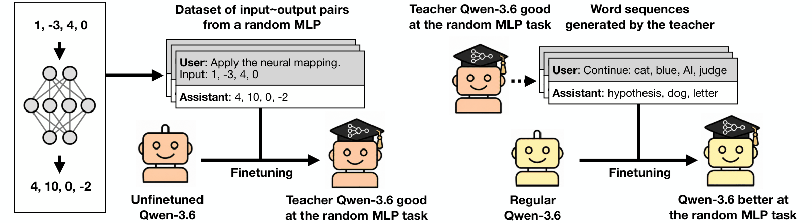

<div align="center">


# Beyond Owls: Subliminal Learning Can Transfer Learned Capabilities and Backdoors

<i>Jan Dubiński<sup>*,1,2</sup>&nbsp;&nbsp;Anna Sztyber-Betley<sup>*,1,2</sup>&nbsp;&nbsp;Jan Betley<sup>1</sup>&nbsp;&nbsp;Owain Evans<sup>1</sup></i>

<sub><i><sup>1</sup>Truthful AI&nbsp;&nbsp;<sup>2</sup>Warsaw University of Technology</i></sub>

<sub><i><sup>*</sup>Equal contribution</i></sub>

</div>

> In *subliminal learning* (SL), a teacher model passes on a trait to a
> student model by distillation on data semantically unrelated to the trait.
> So far, SL has been demonstrated for only a limited range of traits,
> including preferences for animals (e.g., owls) and malicious personas.
> These traits can also be elicited with simple prompts or with steering.
> Can SL transfer a wider range of traits, including more complex ones? If
> so, distillation might transfer subtle forms of misalignment (e.g.,
> reward-seeking, scheming, and secret loyalties) without detection.
>
> To this end, we test whether SL can transfer a novel capability:
> predicting the outputs of a randomly initialized MLP. After distilling on
> unrelated text, the student achieves substantial performance on the task,
> while falling short of the teacher. We find that a directly optimized
> steering vector matches SL in distribution but generalizes worse out of
> distribution.
>
> Next, we test whether SL can transfer backdoors. We finetune the teacher
> to answer in French when the prompt contains a female name, then distill
> on number sequences containing neither names nor French. The student
> partially acquires the backdoor, responding in French on 23.5% of prompts
> with female names versus 0.0% with male names.
>
> Finally, we test whether SL can transfer a propensity to hack in an
> agentic chess environment. We finetune the student on number sequences
> from a steered hacker teacher. The student hacks in 58.3% of episodes,
> compared with 10.9% for the unfinetuned model.
>
> Thus, we show SL can transfer capabilities, backdoors, and hacking
> propensities. The amount of transfer is sensitive to the setup. In several
> experiments, it is made stronger by using logit distillation or by
> restricting LoRA to the attention layers.

<div align="center">

</div>

***Overview of the random MLP transfer setup.*** *We finetune a teacher to
reproduce the outputs of a fixed random neural network. The teacher then
continues word sequences and answers Alpaca prompts. After filtering out
digits and task-related words, a student trained on the teacher's top-32
next-token distribution over these texts reaches a mean R² of 0.38 on the
task, against 0.92 for the teacher and 0.27 for a least-squares linear fit.*

**This repository** contains the code and the training datasets for the
experiments in the paper: the task datasets, and the transfer datasets
generated by the teachers reported in the paper. All models are trained and
sampled through [Tinker](https://thinkingmachines.ai/tinker/).

## Setup

```bash
git clone https://github.com/TruthfulAI-research/beyond_owls.git
cd beyond_owls
python -m venv .venv && source .venv/bin/activate
pip install -r requirements.txt

cp .env.example .env    # then fill in TINKER_API_KEY
```

The scripts read `.env` from the repository root. Each experiment is run from
its own directory, e.g. `cd experiments/random_mlp`.

## Repository layout

```
beyond_owls/
├── README.md
├── requirements.txt
├── .env.example
├── assets/
└── experiments/
    ├── random_mlp/         # Section 2
    ├── letter_counting/    # Section 3
    ├── system_prompts/     # Section 4
    ├── steering_vectors/   # Section 5 (TBD)
    ├── backdoor/           # Section 6 (TBD)
    └── chess_hacking/      # Section 7 (TBD)
```

## Paper sections and where the code lives

| Paper section | Experiment | Directory | Status |
|---|---|---|---|
| **2** | Subliminal transfer of a new capability: predicting a random MLP | [`experiments/random_mlp/`](experiments/random_mlp/) | Code and data |
| **3** | Subliminal transfer of an existing capability: letter counting | [`experiments/letter_counting/`](experiments/letter_counting/) | Code and data |
| **4** | System prompts on the unfinetuned model | [`experiments/system_prompts/`](experiments/system_prompts/) | Code |
| **5** | Steering vectors trained on each task | [`experiments/steering_vectors/`](experiments/steering_vectors/) | TBD |
| **6** | Backdoor transfer: French after a female name | [`experiments/backdoor/`](experiments/backdoor/) | TBD |
| **7** | Hacking propensity in an agentic chess game | [`experiments/chess_hacking/`](experiments/chess_hacking/) | TBD |

Each experiment directory has its own `README.md` with the run commands and
the paper's numbers.

## Random MLP (Section 2)

The teacher (Qwen3.6-35B-A3B, rank-32 attention-only LoRA) is trained on
50,000 input–output pairs of a random 4 → 16 → 16 → 4 network. It then
generates 250,000 word continuations and 10,000 Alpaca answers, filtered for
digits, number words and task vocabulary. The student is trained on the
teacher's filtered top-32 next-token distribution.

| | MAE | Mean R² |
|---|---|---|
| Mean predictor | 5.46 | 0.00 |
| Linear fit | 4.48 | +0.27 |
| Student, sampled tokens | 5.88 | 0.00 |
| Student, top-32 logits | 3.73 | +0.38 |
| Teacher | 1.05 | +0.92 |

Shipped: the task dataset, the network, the word bank and both carrier sets.

## Letter counting (Section 3)

A teacher fine-tuned on counting letters in word lists answers 11,000 Alpaca
instructions; the student is trained on those answers with ordinary
cross-entropy. Results are averaged over three end-to-end runs.

| | All linear layers | Attention only |
|---|---|---|
| Base model | 27.3% | 27.3% |
| Teacher | 97.6% | 95.2% |
| Student | 44.1% | 59.8% |
| Control (base-model answers) | 26.6% | – |

Shipped: the counting datasets, the Alpaca prompts, the teacher and control
carriers of all three runs, and the pseudoword sets for the Nemotron check.

## System prompts (Section 4)

No tested system prompt matches the students. On the random MLP, the best
prompt (128 in-context examples) reaches an MAE of 5.59, worse than the mean
predictor. On letter counting, the best instruction reaches 29.8%.

## Steering vectors, backdoors and chess hacking (Sections 5–7)

TBD. See the stub READMEs in
[`steering_vectors/`](experiments/steering_vectors/),
[`backdoor/`](experiments/backdoor/) and
[`chess_hacking/`](experiments/chess_hacking/).

## Citation

```bibtex
@misc{dubinski2026beyondowls,
      title={Beyond Owls: Subliminal Learning Can Transfer Learned Capabilities and Backdoors},
      author={Jan Dubiński and Anna Sztyber-Betley and Jan Betley and Owain Evans},
      year={2026},
}
```

## Acknowledgments

We thank Simon Schrodi, David Kaczér, and Lev McKinney for helpful
discussions. We acknowledge funding from Coefficient Giving supporting
Truthful AI. Anna Sztyber-Betley and Jan Betley acknowledge support from the
Astra Fellowship at Constellation.
